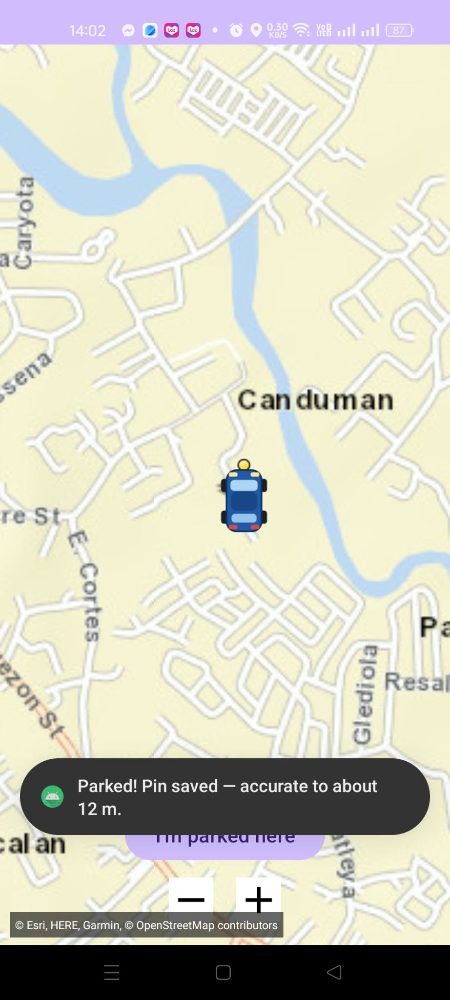
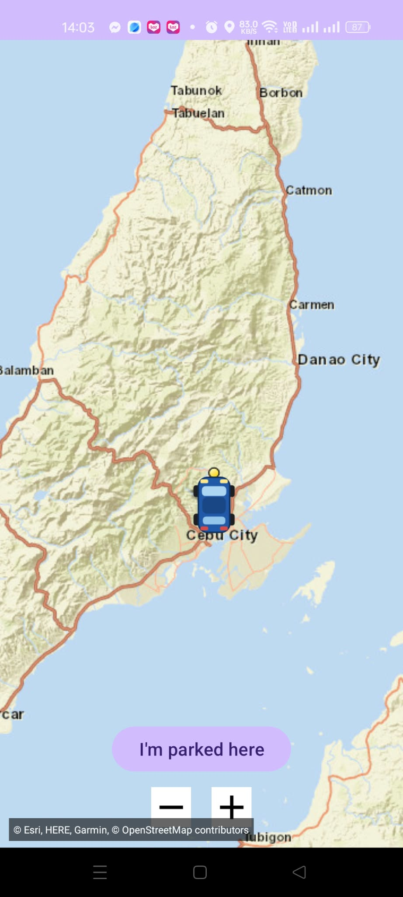
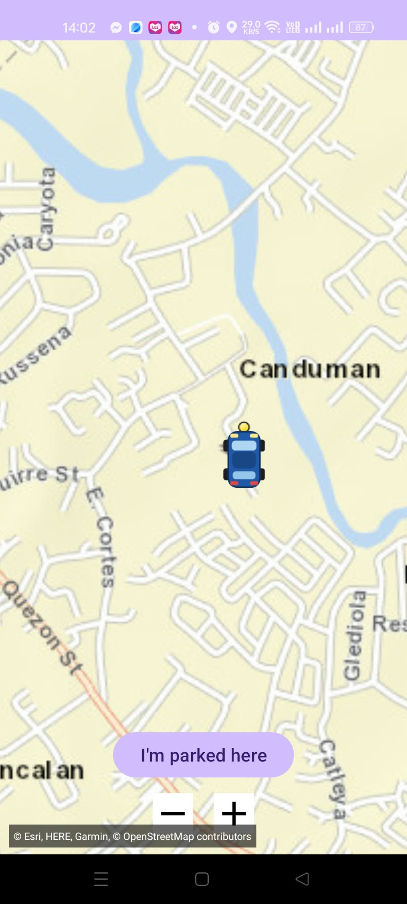

# Parkhere

A small Android app that remembers where you parked. Tap **I'm parked here** to drop a car marker at your current location; the spot is restored automatically the next time you open the app.

## Features

- Live position on an interactive map using `FusedLocationProviderClient` with `PRIORITY_HIGH_ACCURACY`
- **I'm parked here** button that places or moves the car marker
- Accuracy feedback: a toast with the estimated accuracy in metres and a translucent circle around the pin
- One automatic retry after three seconds if the first fix is worse than 25 m
- Runtime permission flow with a rationale dialog and guidance to enable **Precise** location
- Parking spot (coordinates and accuracy) saved locally with `SharedPreferences` and restored on cold start

> [!NOTE]
> Accuracy depends on the device. Outdoors with GPS, expect roughly 3–10 m; indoors or on Wi-Fi/cell only, it can be tens of metres or more. Grant **Precise** location for the best result.

## Screenshots

<p align="center">
  
  
  
</p>

## How it works

1. On launch, the app requests location permission and centres the map on the current fix.
2. `MyLocationNewOverlay` shows the live blue dot; `Marker` renders the car icon.
3. Tapping the button requests a high-accuracy fix and writes latitude, longitude and accuracy to `getPreferences(MODE_PRIVATE)`.
4. `onCreate` reads those values back and restores the pin, so the spot survives being killed and relaunched.

## Map tiles and attribution

The map uses [osmdroid](https://github.com/osmdroid/osmdroid) with Esri World Street Map raster tiles. Tile data is © Esri, HERE, Garmin, USGS and © OpenStreetMap contributors; the attribution strip at the bottom of the map is required by those providers.

> [!NOTE]
> No API key is required. The assignment originally specified a Google Maps Activity, but Google Maps requires a Google Cloud billing account. osmdroid with Esri tiles delivers the same behaviour without credentials. An internet connection is needed to load tiles.

## Requirements

- Android Studio with Android Gradle Plugin 9.4.1 and Kotlin 2.2.10
- JDK 25
- An Android device or emulator running API 33 or higher, with Google Play Services for fused location

## Build and run

Open the project in Android Studio, sync Gradle, and run the `app` configuration.

From a terminal on Windows:

```powershell
.\gradlew.bat :app:assembleDebug
```

The APK is written to `app\build\outputs\apk\debug\app-debug.apk`.

> [!TIP]
> `gradle.properties` pins `org.gradle.java.home` to a local JDK 25 because Gradle was otherwise selecting a JRE without `jlink`. Update that path for your machine, or remove the line once your default JDK is a full JDK 25.

## Project structure

```text
app/src/main/
├── java/com/example/parkhere/MapsActivity.kt   # map, permissions, location, persistence
├── res/layout/activity_maps.xml                # MapView, park button, attribution strip
├── res/drawable/car.png                         # car marker icon
└── AndroidManifest.xml                          # location permissions and launcher activity
```

> [!IMPORTANT]
> `car.png` is a placeholder icon. Replace it with your own asset before submitting.

## Privacy

Location is used only on the device. The only thing saved is the last parked spot (coordinates and estimated accuracy) in app-private SharedPreferences; nothing is uploaded. Map tiles are downloaded from Esri while online.
